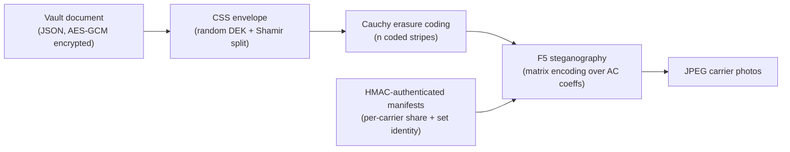

# Ollie — Steganographic Password Vault

**Ollie** hides an AES-256-GCM-encrypted password vault inside ordinary JPEG photos.
The photos look normal, upload to any image host, and survive social-media re-encoding —
but together they carry a tamper-evident, fault-tolerant, post-quantum-resistant secret.

Everything is pure JavaScript: no dependencies, no WebAssembly, no build step.
Every algorithm is hand-implemented in readable modules with exhaustive tests,
so the entire security envelope can be audited end-to-end by one person in an afternoon.

### Feature highlights

- Steganographic multi-carrier storage with threshold (k-of-n) recovery: lose
  carriers and the vault still loads
- Live TOTP (RFC 6238) codes rendered on entry cards with countdown and
  click-to-copy; secrets accepted as bare Base32 or full `otpauth://` URIs
- CSV import from Firefox, Chrome/Google Password Manager, Apple Passwords,
  KeePass, KeePassXC, Bitwarden, and LastPass exports
- Tamper-evident carrier manifests, whole-container Reed-Solomon ECC, atomic
  write-back with rollback

Ollie implements the following published standards natively:

| Standard | What we implement |
|----------|------------------|
| ITU-T T.81 / ISO/IEC 10918-1 | Baseline sequential DCT JPEG encoder and decoder |
| FIPS 197 | AES-256-GCM authenticated encryption |
| FIPS 180-4 | SHA-256 secure hash algorithm |
| RFC 2104 | HMAC-SHA-256 message authentication |
| RFC 2898 (PKCS #5 v2.1) | PBKDF2-HMAC-SHA-256 key derivation |
| NIST SP 800-38D | GCM authenticated encryption mode |
| RFC 4226 | HMAC-based one-time password (HOTP) |
| **RFC 6238** | **Time-based one-time password (TOTP)** |
| RFC 4648 | Base32 data encoding |
| ISO/IEC 18004 | QR Code bar code symbology |

---

## Contributing

See [`CONTRIBUTING.md`](CONTRIBUTING.md) for coding conventions, TDD workflow,
and how to get oriented in the codebase.

## Security model

| Property | Mechanism |
|----------|-----------|
| Confidentiality | AES-256-GCM per entry + AES-256-GCM container envelope |
| Key derivation | PBKDF2-HMAC-SHA-256, 600 000 iterations, per-vault salt |
| Tamper detection | HMAC-SHA-256 carrier manifests (password-gated) |
| Loss tolerance | Cauchy erasure coding + Shamir secret sharing (any *k* of *n* carriers) |
| Replay detection | Strictly increasing revision counter bound into authenticated manifest |
| Size-lie defense | Carrier-bounded framing validation before any allocation |
| Post-quantum resistance | Symmetric-only cryptography: AES-256, SHA-256, HMAC-SHA-256 |

**No asymmetric cryptography is used anywhere.** RSA, ECC, and Ed25519 are all broken
by Shor's algorithm on a sufficiently large quantum computer. Ollie restricts itself to
symmetric primitives, which Grover's algorithm only weakens quadratically (AES-256
retains ~128-bit quantum security). This is documented as a constitutional rule in
`src/specs/rules/constitution.md`.

### What Ollie does NOT protect against

- A keylogger capturing your master password as you type it
- Someone with both your password AND enough surviving carriers
- Quantum computers running Grover's algorithm with > 2^128 logical qubits
  (not expected in the foreseeable future)

---

## Quick start

```bash
git clone https://github.com/your-repo/ollie.git
cd ollie
npm install          # dev tooling only; zero runtime dependencies
npm test             # 675 tests, all green
```

Open `app/vault.html` in a browser (or serve via `npm run serve`) to use the visual vault.

### Headless CLI (Node 22+)

```bash
# Save a vault into carrier photos:
node scripts/cli.mjs save --fromExport vault.json --imagesDir ./photos --outDir ./stego --password "pw"

# Integrity check + identity report:
node scripts/cli.mjs verify --imagesDir ./stego --password "pw"

# Recover carriers back into a portable encrypted envelope:
node scripts/cli.mjs load --imagesDir ./stego --password "pw" --outExport restored.json

# Threshold recovery mode (lose n−k carriers and still recover):
node scripts/cli.mjs save --fromExport vault.json --imagesDir ./photos --outDir ./stego --password "pw" --threshold 2
```

---

## How it works



1. **Seal**: the vault document is encrypted under a fresh random 256-bit DEK (AES-256-GCM).
2. **Split**: the DEK is Shamir-secret-shared across carriers over GF(256).
3. **Code**: the sealed envelope is Cauchy-erasure-coded into coded stripes distributed
   proportionally across carriers by capacity.
4. **Embed**: each stripe + its key share + an HMAC-authenticated manifest are embedded
   into a JPEG photo via F5 matrix encoding over DCT coefficients.
5. **Authenticate**: every carrier carries a copy of the signed manifest; on load, all
   copies must agree, authenticate under the password, and bind every extracted chunk.

Any `threshold` carriers recover the vault. Fewer reveal nothing.
Tampered, swapped, rolled-back, or corrupted sets fail closed.

For the complete byte-level specification see [`src/specs/container-wire-format.md`](src/specs/container-wire-format.md).

---

## Project structure

```
src/
  algebraic/            # Pure math transforms (DCT, quantization, zigzag, color)
  automata/             # Bit-level FSMs (readers, writers, Huffman codecs, parsers)
  codec/                # JPEG encoder, decoder, transcoder, capacity scanner
  information-theory/
    cryptography/       # AES-GCM, PBKDF2, HMAC, SHA-256, WebCrypto provider
    error-correction/   # Reed-Solomon over GF(256), interleaver, profiles
    secret-sharing/     # Shamir, CSS envelope, Cauchy erasure codec, GF(256)
    steganography/      # F5 syndrome, batch embedder/extractor, manifests, chunks
  structures/vault/     # Immutable vault model, secure records
  utils/                # CRC32, encoding, logger, URL safety, atomic writer, escape HTML
  specs/                # Normative specifications and project rules
app/                    # Browser UI (vault page)
scripts/                # CLI, dev server, golden-vector generator, fuzz driver
test/                   # 675+ tests: unit, integration, security, conformance, PBT
docs/audits/            # Historical audit reports
src/specs/WIREFRAME.md # Complete mermaid.js architecture diagram
```

---

## Auditing this codebase

Ollie is designed to be audited. Here's how to approach it:

1. **Read the spec first**: [`src/specs/container-wire-format.md`](src/specs/container-wire-format.md)
   defines the exact byte layout at every layer. If the code doesn't match the spec, that's a bug.

2. **Follow the data flow**: plaintext → CSS seal → erasure code → F5 embed → carrier.
   Each step is a separate module with a narrow interface. Start from `f5-syndrome.js`
   (`embedContainer` / `extractContainer`) and work outward.

3. **Check the crypto surface**: everything lives in `information-theory/cryptography/`.
   There are exactly four primitives: AES-GCM, PBKDF2, HMAC-SHA256, and SHA-256.
   No other cryptographic operations exist in the codebase.

4. **Verify the claims**: run `npm test` (675 assertions), then `npm run fuzz --scale=10`
   for deeper property-based exploration. Golden vectors in `test/conformance/golden-vectors.json`
   pin bit-exact wire format behavior.

5. **Review the audit trail**: three independent audits are archived in `docs/audits/`
   with findings tracked through remediation waves A–K (see git history).

---

## Testing

> **Language convention:** Ollie is 100% vanilla JavaScript with JSDoc type annotations.
> No TypeScript source exists. The optional `typecheck` script runs `tsc --checkJs`
> purely as a JSDoc linter — it validates annotations, compiles nothing, and emits nothing.

```bash
npm test               # Full suite: 675 tests
PBT_SEED=N npm test   # Reproducible property-based runs
npm run fuzz           # Long-run fuzz driver (all suites, scalable iterations)
npm run lint           # ESLint
npm run typecheck      # Validates JSDoc type annotations (no TypeScript)
```

Test families:

| Family | Count | Purpose |
|--------|-------|---------|
| Unit | ~350 | Per-module correctness |
| Integration | ~80 | Cross-module pipelines |
| Security | ~60 | Forged input rejection, hardening, XSS/scheme injection |
| Conformance | 13 | Bit-exact golden vectors for frozen wire format |
| Property-based | 12 | Seeded invariant fuzzing of ECC/F5/container/chunk layers |
| Fuzz | ~20 | Structure-aware mutation, differential testing, model-based sequences |
| UI | ~15 | Vault UI interactions |

CI runs lint + JSDoc validation + seeded tests + fuzz smoke + stale-vector guard on every push.

---

## Design principles

These are codified in [`src/specs/rules/`](src/specs/rules/) and enforced by convention:

1. **Zero runtime dependencies.** Dev tooling (ESLint, JSDoc type validation) is documented exception.
2. **Result tuples everywhere.** `[value|null, error|null]` — never throw for predictable failures.
3. **Post-quantum symmetric-only crypto.** No asymmetric primitives (see constitution).
4. **Fail closed.** Invalid input, corruption, or tampering produces an explicit error, never partial output.
5. **TDD red-green-refactor.** Tests are written before implementation.
6. **Living architecture wireframe.** Structural changes update `WIREFRAME.md` in the same commit.
7. **Auditable above all.** Every design decision has a rationale traceable in specs, comments, or git history.

---

## Roadmap

Completed remediation waves (see git history):

- **A–G**: Audit closeout, wire format conformance, seeded PBT, tooling/CI
- **H1–H2**: Signed carrier manifests, CSS threshold recovery
- **I**: Erasure-coded carrier sets
- **J1–J5**: Full-stack fuzzing and metamorphic testing
- **K**: Whole-container ECC framing (format v3)

Remaining items are tracked in `src/specs/TODO`.

---

## License

ISC
