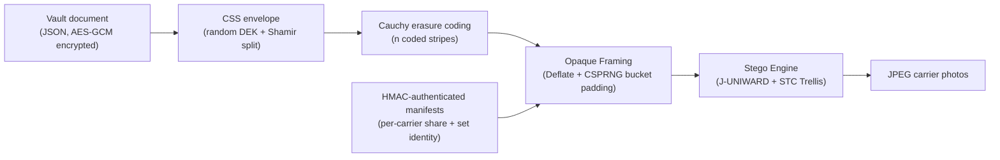

# Ollie — Steganographic Password Vault

**Ollie** hides an AES-256-GCM-encrypted password vault inside ordinary JPEG photos.
The photos look normal, upload to any image host, and survive social-media re-encoding —
while carrying a tamper-evident, fault-tolerant, post-quantum-resistant secret.

Everything is plain JavaScript with zero runtime npm dependencies. A single, auditable,
vendored WebAssembly binary (`src/vendor/argon2/` from OpenPGP.js) provides side-channel
timing-attack-immune Argon2id memory-hard key derivation. Every algorithm is hand-implemented
in readable modules with exhaustive tests, so the entire security envelope can be audited
end-to-end by one person in an afternoon.

---

### Feature Highlights

- **Format v4 Steganography:** Rate-distortion optimal **Syndrome-Trellis Codes (STC)** combined with **J-UNIWARD** spatial Daubechies 8-tap (db8) wavelet distortion modeling and anti-SCA key randomization.
- **Zero Plaintext Metadata & Zero-Length Opaque Framing:** No unencrypted headers, magic bytes, length counters, or salt metadata are exposed in the carrier. Ciphertexts are padded with CSPRNG noise to discrete power-of-two buckets ($256\text{B} \dots 128\text{KB}$).
- **Argon2id Key Derivation Chain (RFC 9106):** High-work-factor memory-hard password hashing ($t=3, m=64\text{MB}, p=1$) + RFC 5869 HKDF domain separation for AES keys, IVs, STC matrices, and distortion seeds.
- **Multi-Carrier Storage with Threshold ($k$-of-$n$) Recovery:** Cauchy MDS erasure coding over $\text{GF}(256)$ and Shamir secret sharing: lose carriers down to the threshold and the vault still loads.
- **Live TOTP (RFC 6238):** Live 2FA codes rendered directly on entry cards with progress countdown and click-to-copy; secrets accepted as bare Base32 or full `otpauth://` URIs.
- **Universal CSV Import:** Direct password migration from Firefox, Chrome / Google Password Manager, Apple Passwords, KeePass, KeePassXC, Bitwarden, and LastPass exports.
- **Tamper-Evident Carrier Manifests:** Whole-container HMAC authentication, revision counters, and atomic write-back with automatic rollback on partial write failure.

---

### Published Standards Implemented

| Standard | What We Implement |
|----------|------------------|
| ITU-T T.81 / ISO/IEC 10918-1 | Baseline sequential DCT JPEG encoder and decoder |
| FIPS 197 | AES-256-GCM authenticated encryption |
| FIPS 180-4 | SHA-256 secure hash algorithm |
| RFC 2104 | HMAC-SHA-256 message authentication |
| **RFC 9106** | **Argon2id memory-hard password hashing ($t=3, m=64\text{MB}, p=1$)** |
| **RFC 5869** | **HKDF (HMAC-SHA-256) domain separation expansion** |
| RFC 2898 (PKCS #5 v2.1) | PBKDF2-HMAC-SHA-256 key derivation (vault internal document store) |
| NIST SP 800-38D | GCM authenticated encryption mode |
| **IEEE TIFS 2011** | **Syndrome-Trellis Codes (STC) dual-trellis Viterbi matrix encoding** |
| **EURASIP 2014** | **J-UNIWARD spatial Daubechies db8 wavelet distortion modeling** |
| RFC 4226 | HMAC-based one-time password (HOTP) |
| **RFC 6238** | **Time-based one-time password (TOTP)** |
| RFC 4648 | Base32 data encoding |
| ISO/IEC 18004 | QR Code bar code symbology (encoder and decoder) |

---

## Contributing

See [`CONTRIBUTING.md`](CONTRIBUTING.md) for coding conventions, TDD workflow,
and how to get oriented in the codebase.

## Security Model

### Optional TOTP Gate (Tier B)

Vault creation can enroll an optional TOTP code gate. **This is access control for the UI session,
not extra encryption**: the secret lives inside the encrypted vault document,
so anyone who has your master password can decrypt the vault file directly. It exists
to deter shoulder-surfing and opportunistic access to an unlocked session.
The enrollment dialog states this disclaimer verbatim.

| Property | Mechanism |
|----------|-----------|
| Confidentiality | AES-256-GCM per entry + AES-256-GCM opaque container envelope |
| Key Derivation | Argon2id ($t=3, m=64\text{MB}, p=1$) $\to$ HKDF-Expand (RFC 5869) |
| Steganography | Syndrome-Trellis Codes (STC, $h=8, w \le 16$) + J-UNIWARD spatial wavelet costs |
| Length Hiding | Zero-length framing + CSPRNG noise bucket padding ($256\text{B} \dots 128\text{KB}$) |
| Tamper Detection | HMAC-SHA-256 carrier manifests (password-gated) |
| Loss Tolerance | Cauchy MDS erasure coding + Shamir secret sharing (any $k$ of $n$ carriers) |
| Replay Detection | Strictly increasing revision counter bound into authenticated manifest |
| Size-Lie Defense | Carrier-bounded framing validation before any memory allocation |
| Post-Quantum Resistance | Symmetric-only cryptography: AES-256, SHA-256, HMAC-SHA-256, Argon2id |

**No asymmetric cryptography is used anywhere.** RSA, ECC, and Ed25519 are all broken
by Shor's algorithm on a sufficiently large quantum computer. Ollie restricts itself to
symmetric primitives, which Grover's algorithm only weakens quadratically (AES-256
retains ~128-bit quantum security). This is documented as a constitutional rule in
[`src/specs/rules/constitution.md`](src/specs/rules/constitution.md).

### What Ollie Does NOT Protect Against

- A keylogger capturing your master password as you type it
- Someone with both your password AND enough surviving carriers
- Quantum computers running Grover's algorithm with $> 2^{128}$ logical qubits

---

## Quick Start

```bash
git clone https://github.com/your-repo/ollie.git
cd ollie
npm test             # Full suite: 874 tests, all green
```

Open `app/vault.html` in a modern browser (or serve locally via `npm run serve`) to use the visual vault.

### Headless CLI (Node 22+)

```bash
# Save a vault into carrier photos:
node scripts/cli.mjs save --fromExport vault.json --imagesDir ./photos --outDir ./stego --password "pw"

# Integrity check + identity report:
node scripts/cli.mjs verify --imagesDir ./stego --password "pw"

# Recover carriers back into a portable encrypted envelope:
node scripts/cli.mjs load --imagesDir ./stego --password "pw" --outExport restored.json

# Threshold recovery mode (lose n−k carriers and still recover):
node scripts/cli.mjs save --fromExport vault.json --imagesDir ./photos --outDir ./stego --password "pw" --threshold 2
```

---

## How It Works



1. **Seal**: the vault document is encrypted under a fresh random 256-bit DEK (AES-256-GCM).
2. **Split**: the DEK is Shamir-secret-shared across carriers over $\text{GF}(256)$.
3. **Code**: the sealed envelope is Cauchy-erasure-coded into coded stripes distributed
   proportionally across carriers by capacity.
4. **Opaque Frame**: each stripe + its key share + signed manifest are compressed, CRC-32-checked,
   and padded with CSPRNG noise into a zero-length bucket ($256\text{B} \dots 128\text{KB}$) encrypted via AES-256-GCM.
5. **Embed**: the wire envelope is embedded into JPEG DCT AC coefficients using Syndrome-Trellis Codes
   (STC) with distortion costs calculated via J-UNIWARD spatial Daubechies db8 wavelets.
6. **Authenticate**: every carrier carries an authenticated manifest; on load, all
   copies must agree, verify under the password, and bind every extracted chunk.

Any `threshold` carriers recover the vault. Fewer reveal nothing.
Tampered, swapped, rolled-back, or corrupted sets fail closed.

For the complete byte-level specification see [`src/specs/container-wire-format.md`](src/specs/container-wire-format.md).

---

## Project Structure

```text
src/
  algebraic/            # Pure math transforms (DCT, quantization, zigzag, color)
  automata/             # Bit-level FSMs (readers, writers, Huffman codecs, parsers)
  codec/                # JPEG encoder, decoder, transcoder, capacity scanner, QR
  information-theory/
    cryptography/       # KDF chain (Argon2id + HKDF), AES-GCM, PBKDF2, HMAC, TOTP
    error-correction/   # Reed-Solomon over GF(256), interleaver, profiles
    secret-sharing/     # Shamir, CSS envelope, Cauchy erasure codec, GF(256)
    steganography/      # StegoEngine, OpaqueContainer, STCMatrix, JUniward, manifests, chunks
  structures/vault/     # Immutable vault model, secure records, CSV import
  utils/                # Compression, CRC32, encoding, logger, URL safety, atomic writer
  vendor/               # Vendored OpenPGP.js Argon2id WASM SIMD/non-SIMD engine
  specs/                # Normative specifications, project rules, living wireframe
app/                    # Browser UI (vault page, test runner)
scripts/                # CLI, dev server, golden-vector generator
test/                   # 874 tests: unit, integration, security, conformance, PBT
src/specs/WIREFRAME.md  # Complete mermaid.js architecture diagram
```

---

## Auditing This Codebase

Ollie is designed to be audited:

1. **Read the spec first**: [`src/specs/container-wire-format.md`](src/specs/container-wire-format.md)
   defines the exact byte layout at every layer.
2. **Follow the data flow**: plaintext $\to$ CSS seal $\to$ Cauchy erasure code $\to$ Opaque bucket framing $\to$ STC / J-UNIWARD embed $\to$ carrier.
3. **Check the crypto surface**: everything lives in `information-theory/cryptography/` and `src/vendor/argon2/`.
   Primitives: Argon2id, HKDF-Expand, AES-256-GCM, HMAC-SHA256, SHA-256.
4. **Verify the claims**: run `npm test` (874 assertions).
5. **Inspect the WASM binary**: `src/vendor/argon2/` contains the unmodified OpenPGP.js Argon2id WASM binary alongside its original MIT license, inlined as base64 to ensure zero-network offline operation.

---

## Testing

```bash
npm test               # Full suite: 874 tests
PBT_SEED=N npm test   # Reproducible property-based runs
npm run lint           # ESLint
npm run typecheck      # Validates JSDoc type annotations (no TypeScript)
```

---

## License

ISC
