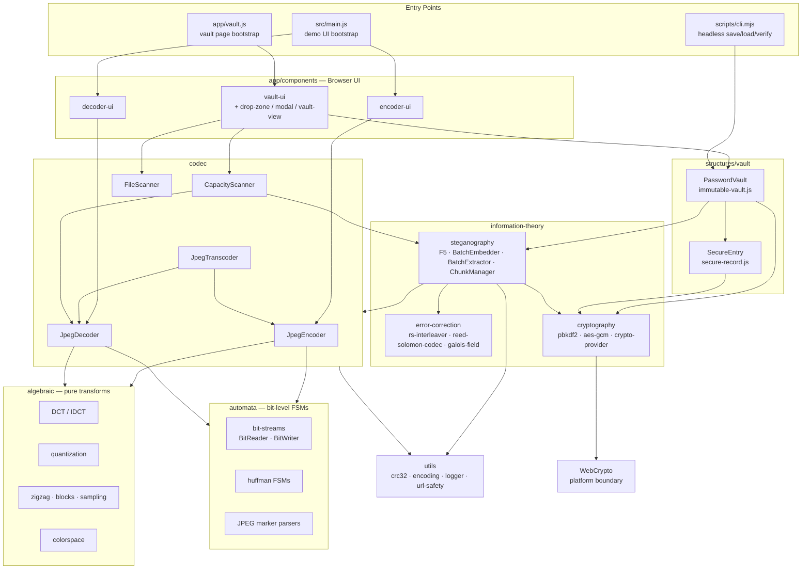
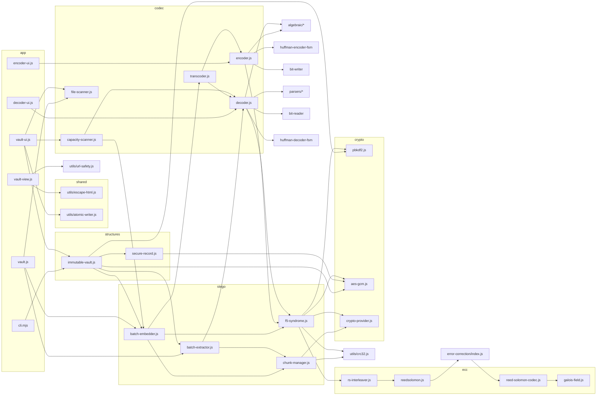
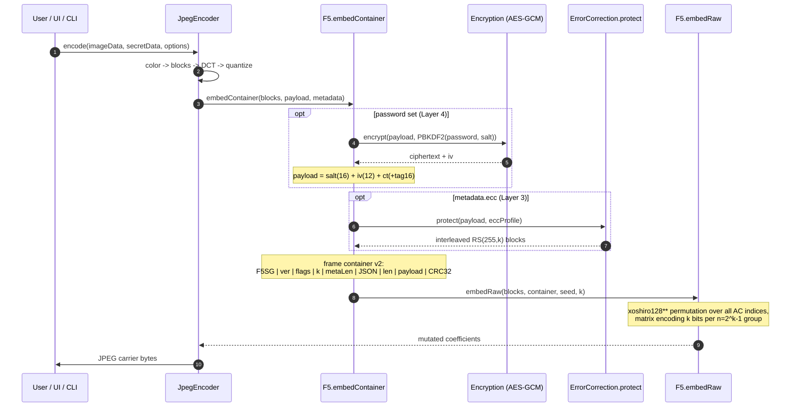
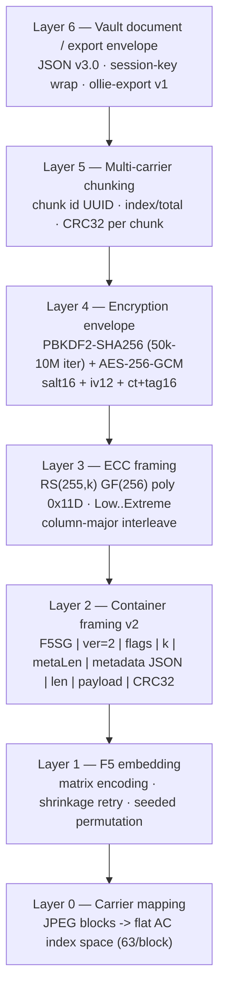
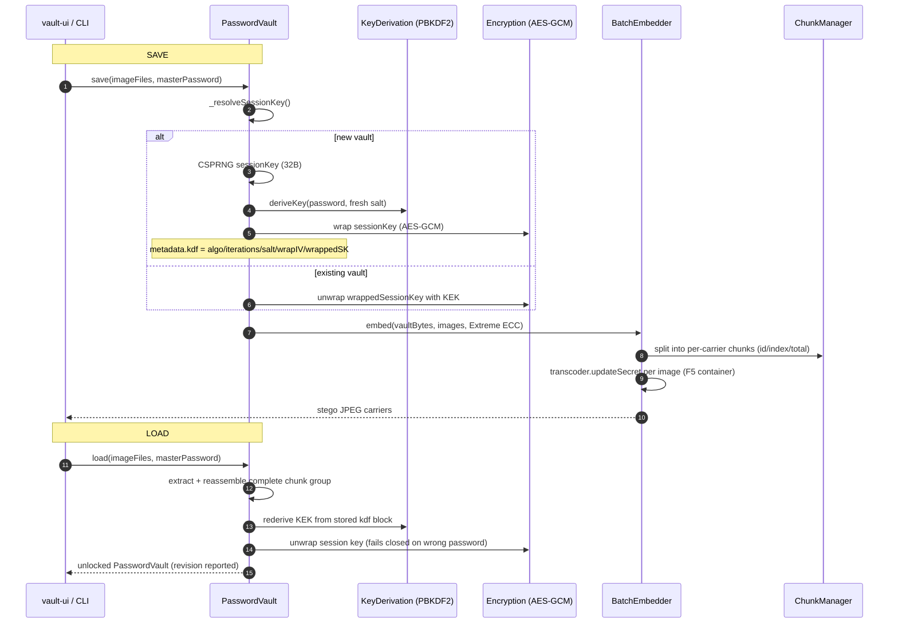
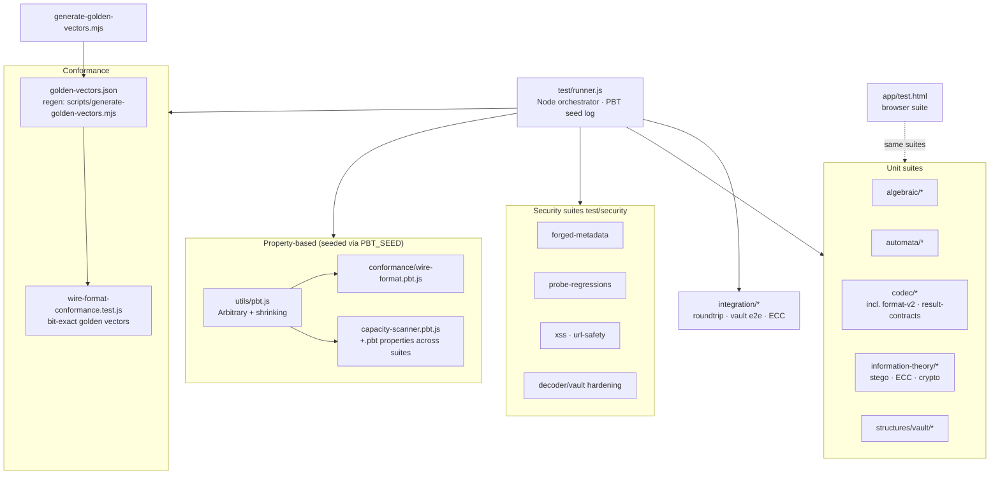

# Ollie — Project Wireframe

Complete mermaid.js map of the codebase: layers, module dependencies,
runtime pipelines, the wire-format stack, vault flows, and test architecture.

> **Living document** — see `src/specs/rules/code-quality.md` rule 15.
> Any change that adds/removes/renames/moves a module or changes a
> cross-layer dependency MUST update this file in the same change.
>
> Wire-level byte formats are normatively specified in
> `src/specs/container-wire-format.md`; this document shows structure only.

---

## 1. Directory Layout

```text
Ollie/
├── app/                          # Browser UI (ES modules, no framework)
│   ├── index.html / debug.html / test.html / vault.html
│   ├── main.js                   # Demo entry point (encoder/decoder tabs)
│   ├── vault.js                  # Vault page bootstrap
│   └── components/
│       ├── encoder-ui.js         # Encode tab (quality, ECC options)
│       ├── decoder-ui.js         # Decode tab (IDCT/bitreader switching)
│       ├── tabs.js               # Tab shell
│       └── vault/
│           ├── vault-ui.js       # Vault orchestrator (save/load/search)
│           └── components/
│               ├── drop-zone.js      # File drop (folder traversal)
│               ├── modal-manager.js  # Confirm/prompt dialogs
│               └── vault-view.js     # Entry list + URL safety gate
├── scripts/
│   ├── cli.mjs                   # Headless vault save/load/verify
│   ├── dev-server.js             # Local dev server
│   ├── generate-golden-vectors.mjs  # Regenerates conformance vectors
│   └── debug-rs-limit.js         # RS debugging aid
├── src/
│   ├── algebraic/                # Pure math transforms (no I/O)
│   │   ├── colorspace/           # rgb-to-ycbcr
│   │   ├── discrete-cosine/      # forward-dct, inverse-dct (+spec variants)
│   │   ├── mappings/             # blocks, zigzag, up/downsampling, assembly
│   │   └── quantization/         # forward/inverse quantization
│   ├── automata/                 # Bit-level state machines
│   │   ├── bit-streams/          # bit-reader(s), bit-writer, bit-core
│   │   ├── entropy-coding/       # huffman encoder/decoder FSMs
│   │   └── parsers/              # marker/dht/dqt/sof/sos/spiff automata
│   ├── codec/                    # High-level orchestrators
│   │   ├── encoder.js  decoder.js  transcoder.js
│   │   ├── capacity-scanner.js  file-scanner.js
│   ├── information-theory/
│   │   ├── cryptography/         # pbkdf2, aes-gcm, crypto-provider
│   │   ├── error-correction/     # galois-field, reed-solomon-codec, rs-interleaver
│   │   └── steganography/        # f5-syndrome, batch-embedder/-extractor, chunk-manager
│   ├── structures/vault/         # immutable-vault, secure-record
│   ├── utils/                    # crc32, encoding, logger, url-safety,
│   │                             # escape-html, atomic-writer
│   └── specs/                    # Normative specs and project rules
├── test/                         # Node runner + browser suite (see §7)
├── docs/audits/                  # Historical audit reports (archived)
└── WIREFRAME.md                  # This file
```

---

## 2. Layered Architecture

Strict downward dependencies only — no upward imports anywhere in the codebase.



---

## 3. Module Dependency Graph (verified import edges)



---

## 4. Steganographic Encode/Extract Pipeline



Extraction mirrors it: `JpegDecoder.decode` collects blocks and calls
`F5.extractAuto`, which scans k=1..4 for the `F5SG` magic, parses the header,
verifies CRC32 (attempting ECC recovery when `metadata.ecc`), unwraps AES when
encrypted, and returns `{ data, metadata }`. `BatchExtractor` then groups chunk
records across carriers and reassembles via `ChunkManager`.

---

## 5. Wire-Format Stack (v2, frozen)

Byte-exact conformance vectors: `test/conformance/golden-vectors.json`.



---

## 6. Vault Save / Load Flow



---

## 7. Test Architecture



---

## 8. Maintenance Rules

Tracked by `src/specs/rules/code-quality.md` rule 15 (the canonical spec tree):

1. Add/remove/rename/move a module -> update §1 tree, §2 layer graph, §3 edges.
2. Change a cross-module import edge -> update §3 only.
3. Change a runtime pipeline or wire-format layer -> update §4/§5.
4. Add a test suite family or vector source -> update §7.
5. Regenerate golden vectors after any *intentional* format change, never to
   make a failing suite pass.

