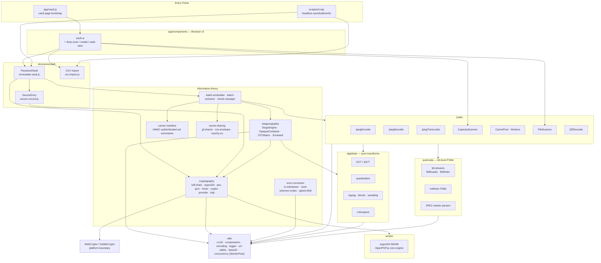
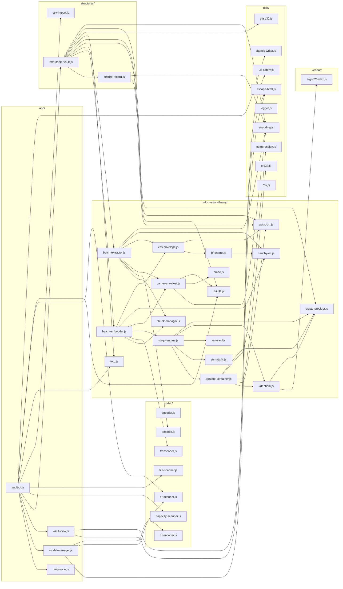
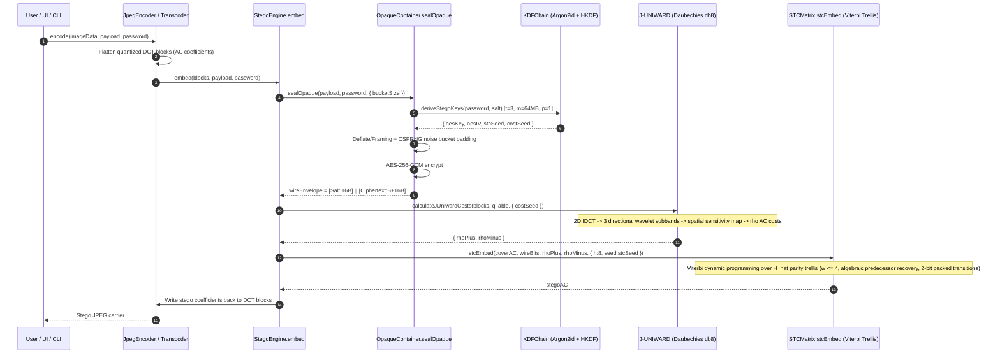
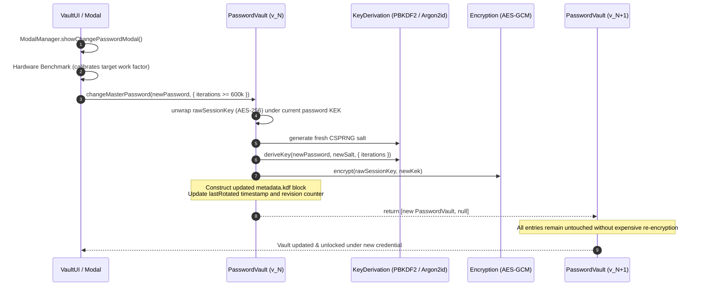
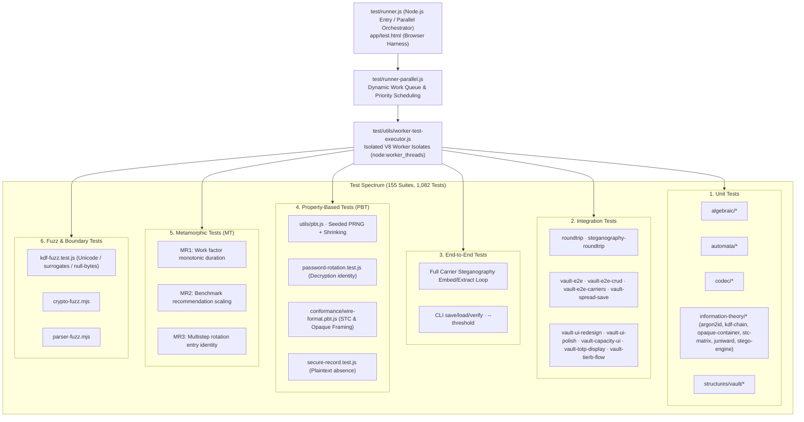

# Ollie — Project Wireframe

Complete mermaid.js map of the codebase: layers, module dependencies,
runtime pipelines, the wire-format stack, vault flows, and test architecture.

> **Living document** — see `src/specs/rules/code-quality.md` rule 15.
> Any change that adds/removes/renames/moves a module or changes a
> cross-layer dependency MUST update this file in the same change.
>
> Wire-level byte formats are normatively specified in
> `src/specs/container-wire-format.md`; this document shows structure only.

---

## 1. Directory Layout

```text
Ollie/
├── app/                          # Browser UI (ES modules, no framework)
│   ├── vault.html                # Vault page (entry HTML)
│   ├── test.html                 # Browser test runner (mirrors Node suite)
│   ├── vault.js                  # Vault page bootstrap
│   └── components/
│       ├── assets/               # SVG icons
│       └── vault/
│           ├── vault-ui.js       # Vault orchestrator (onboarding, rotation, 2FA, save/load/search)
│           ├── vault.css         # Styling: toasts, wizard, card grid, modals
│           └── components/
│               ├── drop-zone.js          # File drop (folder traversal)
│               ├── modal-manager.js      # Modal manager orchestrator
│               ├── onboarding-wizard.js  # First-run onboarding wizard
│               ├── qr-canvas.js          # QR code canvas renderer
│               ├── vault-modals.js       # Change password, 2FA settings, shortcuts modals
│               └── vault-view.js         # Card grid renderer + selection & scroll anchor
├── scripts/
│   ├── cli.mjs                   # Headless vault save/load/verify
│   ├── dev-server.js             # Local dev server
│   └── generate-golden-vectors.mjs # Regenerates conformance vectors
├── src/
│   ├── algebraic/                # Pure math transforms (no I/O)
│   │   ├── colorspace/           # rgb-to-ycbcr
│   │   ├── discrete-cosine/      # forward-dct, inverse-dct (+spec variants)
│   │   ├── mappings/             # blocks, zigzag, up/downsampling, assembly
│   │   └── quantization/         # forward/inverse quantization
│   ├── automata/                 # Bit-level state machines
│   │   ├── bit-streams/          # bit-reader(s), bit-writer, bit-core
│   │   ├── entropy-coding/       # huffman encoder/decoder FSMs
│   │   └── parsers/              # marker/dht/dqt/sof/sos/spiff automata
│   ├── codec/                    # High-level orchestrators
│   │   ├── encoder.js  decoder.js  transcoder.js
│   │   ├── capacity-scanner.js  carrier-pool.js  carrier.worker.js  file-scanner.js
│   │   └── qr-encoder.js     qr-decoder.js
│   ├── information-theory/
│   │   ├── cryptography/         # kdf-chain (Argon2id + HKDF), kdf.worker.js, pbkdf2, aes-gcm, hmac, totp, crypto-provider
│   │   ├── error-correction/     # galois-field, reed-solomon-codec, rs-interleaver
│   │   ├── secret-sharing/       # gf-shamir (k-of-n), css-envelope, cauchy-ec
│   │   └── steganography/        # stego-engine, opaque-container, stc-matrix, juniward,
│   │                             # chunk-manager, carrier-manifest, batch-embedder/-extractor
│   ├── structures/vault/         # immutable-vault, secure-record, csv-import
│   ├── utils/                    # crc32, encoding, compression, logger, url-safety,
│   │                             # escape-html, atomic-writer, csv, base32, password-strength,
│   │                             # concurrency (worker-pool, worker-adapter, worker-runtime, tuple-serializer)
│   ├── vendor/argon2/            # Vendored OpenPGP.js Argon2id WASM SIMD/non-SIMD engine
│   └── specs/                    # Normative specs and project rules
├── test/                         # Node runner + browser suite (see §6)
└── src/specs/WIREFRAME.md        # This file
```

---

## 2. Layered Architecture

Strict downward dependencies only — no upward imports anywhere in the codebase.



---

## 3. Module Import Graph



---

## 4. Format v4 Steganographic Embed/Extract Pipeline



---

## 5. Master Password & Salt Rotation Pipeline



---

## 6. Multi-Methodology Test Spectrum (Rule 14)


